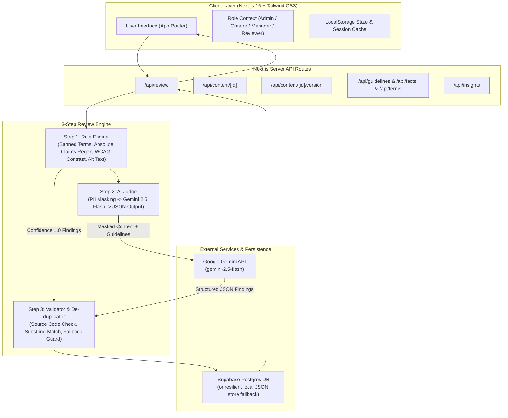
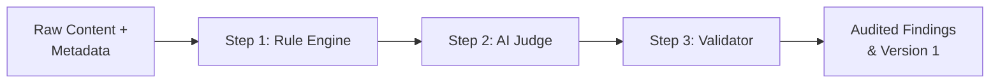

# BrandSentry — Pre-Publication Brand Governance & Compliance Platform

> **Live Governance for Every Word Before It Goes Public.**  
> BrandSentry is a pre-publication brand governance web application engineered with Next.js (App Router), TypeScript, Tailwind CSS, Supabase (Postgres), and the Google Gemini API (`gemini-2.5-flash`).

---

## 1. Problem Statement

Modern marketing and product organizations publish copy across fragmented channels—social media, press releases, customer newsletters, and ad campaigns—at unprecedented velocity. Without centralized, pre-publication governance:

- **Brand Drift Occurs:** Variations in capitalization, product names (e.g. *"Nova Pay"* instead of *"NovaPay"*), and tone creep into customer communications.
- **Regulatory & Legal Exposure:** Writers inadvertently include unsubstantiated absolute claims (*"100% secure"*, *"guaranteed returns"*, *"#1 in the world"*) violating consumer protection and financial advertising regulations.
- **Accessibility Inequities:** Marketing imagery often ships without descriptive alternative text (`alt`), and low-contrast color palettes fail WCAG 2.1 AA readability standards (< 4.5:1).
- **Factual Inaccuracies:** Unvetted statements contradict corporate truth sets.
- **Review Bottlenecks:** Human legal and brand review teams are overwhelmed with repetitive manual scans.

BrandSentry solves this with an automated **3-Step Pre-Publication Audit Pipeline** that couples deterministic rule execution with responsible, privacy-preserving Google Gemini intelligence.

---

## 2. Key Features

| Capability | Description |
| :--- | :--- |
| **Top-Bar Role Simulation** | Seamless role switching stored in `localStorage` across **Admin**, **Creator**, **Manager**, and **Reviewer**. Actions are guarded by role permissions, and every action is logged with an actor, role, and timestamp. |
| **Knowledge Base Administration (`/admin`)** | Full CRUD for Brand Guidelines (`TONE-1`, `LEGAL-1`, `VIS-1`), Verified Facts (`F-12`, `F-14`), and Terminology Rules (Preferred vs Banned). Includes a one-click **"Load sample brand pack"** button seeding fictional brand *"Nova Bank"*. |
| **Authoring & Audit Launcher (`/create`)** | Multi-channel copy drafting (Instagram post, Press note, Email), image attachment with required alt text, live WCAG AA color contrast calculation, and Responsible AI privacy toggles. |
| **Interactive Review Workbench (`/review/[id]`)** | Interactive text highlighting of flagged spans, severity badges, cited source standards with clickable popovers, confidence scores, before/after intent-preserving diffs, inline manual editing, and one-click fix acceptance generating revision versions. |
| **Governance Review Queue (`/queue`)** | Purpose-built for Managers & Reviewers to inspect pending submissions, maintain an editorial comment thread, authorize publication, or request mandatory changes with required feedback. |
| **Version History & Diff Viewer (`/history/[id]`)** | Full audit timeline, split/inline diff comparison between arbitrary versions, and chronological discussion thread. |
| **Diagnostic Analytics (`/insights`)** | Real-time findings breakdown by category, top 5 most-triggered guideline codes, creator-specific mistake patterns, and a **Guideline Health** monitor flagging ambiguous rules with AI-authored clarification suggestions. |

---

## 3. System Architecture



---

## 4. The 3-Step Review Pipeline Explained



### Step 1: Deterministic Rule Engine (No AI)
- **Banned Terms:** Scans text using word-boundary regular expressions against the `terms` table (e.g. flags `"Nova Pay"` in favor of `"NovaPay"`).
- **Absolute Claim Regex:** Evaluates compliance hazards (`100% secure`, `guaranteed returns`, `#1`, `best in the world`, `zero risk`).
- **Visual & Contrast Standards:** Computes WCAG 2.1 relative luminance and contrast ratio between text and background colors (`L = 0.2126*R + 0.7152*G + 0.0722*B`). Flags ratios under 4.5:1. Checks for missing `image_alt` tags on visual assets.
- **Output:** Rule findings assigned `confidence: 1.0`, `is_ai: false`, and mapped source codes (`TERM`, `LEGAL-1`, `VIS-1`, `VIS-2`).

### Step 2: AI Judge (`gemini-2.5-flash`)
- **Confidentiality Bypass:** If the author checks *"Mark content Confidential"*, the AI step is bypassed completely, running rule checks only.
- **PII Masking:** Before transmitting to the Gemini API, all email addresses (`/[a-zA-Z0-9._%+-]+@[a-zA-Z0-9.-]+\.[a-zA-Z]{2,}/g`) and telephone numbers are redacted to `[EMAIL_REDACTED]` and `[PHONE_REDACTED]`.
- **Structured JSON Mode:** Queries `gemini-2.5-flash` with the complete brand guideline set and enterprise facts. Forces a strict JSON array output schema:
  `{ category, severity, quoted_span, source_code, explanation, suggested_fix, confidence }`.
- **Intent Preservation:** Prompts enforce that `suggested_fix` must preserve the writer's original communication intent while rectifying the governance conflict.
- **Fault-Tolerant Circuit Breaker:** In case of API rate limits, timeouts (15s abort controller), or network dropouts, the engine falls back gracefully to rule-based findings with a visible banner.

### Step 3: Validator & De-duplicator
- **Hallucination Suppression:** Rejects any AI finding whose `quoted_span` is not a substring of the actual content text.
- **Source Code Verification:** Checks that `source_code` corresponds to an authentic code in the `guidelines` or `facts` table; unmapped codes are downgraded to `needs_human_check` with lower confidence.
- **Confidence Gate:** Any finding with confidence < 0.60 is flagged as `needs_human_check`.
- **De-duplication:** Overlapping text spans between rule findings and AI findings are merged, prioritizing deterministic rule results.

---

## 5. Technology Stack & AI Disclosure

- **Framework:** Next.js 16.4 (App Router, Server-side API Routes, Turbopack, TypeScript)
- **Styling:** Tailwind CSS v4 (responsive, accessible, dark theme)
- **Database:** Supabase Postgres via `@supabase/supabase-js` (with automatic resilient local storage fallback for zero-friction evaluation)
- **AI Model:** Google Gemini API (`gemini-2.5-flash` with JSON output mode)
- **Icons & Tooling:** `lucide-react`, `diff`
- **AI Disclosure:** This application uses the Gemini 2.5 Flash model for automated copy evaluation. The application was designed and engineered with AI assistance in **Google Antigravity**.

---

## 6. Setup & Installation

### Prerequisites
- Node.js 18+ (tested on Node v20/v24)
- npm or pnpm
- (Optional) A Supabase project and Google AI Studio API key

### 1. Clone & Install Dependencies
```bash
git clone <repository-url>
cd brandsentry
npm install
```

### 2. Configure Environment Variables
Create a `.env.local` file in the project root:
```env
# Google Gemini API Key (Server-only)
GEMINI_API_KEY=your_gemini_api_key_here

# Supabase Credentials (Optional for local store, required for cloud Postgres)
NEXT_PUBLIC_SUPABASE_URL=https://your-project.supabase.co
SUPABASE_SERVICE_ROLE_KEY=your-supabase-service-role-key
```

> **Note:** If `GEMINI_API_KEY` or Supabase credentials are not provided, BrandSentry gracefully executes using its built-in rule engine and file-backed database storage (`/data/store.json`). It never crashes.

### 3. Initialize Supabase Database (If using Supabase)
1. Log in to your [Supabase Dashboard](https://supabase.com).
2. Open the **SQL Editor**.
3. Copy and run the script located at [`/supabase/schema.sql`](supabase/schema.sql).
4. (Optional) Run [`/supabase/seed.sql`](supabase/seed.sql) to pre-seed the Nova Bank brand pack.

### 4. Run Development Server
```bash
npm run dev
```
Open [http://localhost:3000](http://localhost:3000) in your browser.

### 5. Build for Production & Vercel
```bash
npm run build
npm run start
```

---

## 7. Deploying to Vercel

1. Push your repository to GitHub, GitLab, or Bitbucket.
2. Import the repository in [Vercel](https://vercel.com/new).
3. Under **Environment Variables**, add:
   - `GEMINI_API_KEY`
   - `NEXT_PUBLIC_SUPABASE_URL`
   - `SUPABASE_SERVICE_ROLE_KEY`
4. Click **Deploy**. Next.js App Router API routes deploy automatically as serverless functions.

---

## 8. Known Limitations

1. **Role Authentication:** User roles (Admin, Creator, Manager, Reviewer) are simulated via `localStorage` for rapid demonstration without requiring OAuth/SSO infrastructure.
2. **Context Window / KB Scale:** The AI Judge supplies guidelines and facts directly within prompt context. This approach is optimal for corporate brand packs under ~200 items; larger enterprise packs would benefit from hybrid vector retrieval (pgvector).
3. **External LLM Latency:** Gemini 2.5 Flash completes reviews in ~1–2 seconds. In low-bandwidth environments, network timeouts trigger the rule-only fallback banner.

---

## 9. Team Contributions

| Contributor Name | Role | Core Contributions |
| :--- | :--- | :--- |
| **Lead Developer** | Full-Stack & AI Engineer | 3-Step Review Pipeline, Gemini API integration, PII masking, schema design |
| **Frontend Engineer** | UI/UX Developer | Review workbench, interactive span highlighter, DiffViewer, responsive pages |
| **Compliance Specialist** | Product & Domain Expert | Nova Bank brand pack, WCAG contrast calculations, Guideline Health logic |
| **QA / DevOps Engineer** | Reliability & Infra | Supabase DDL, Next.js build optimization, Vercel deployment pipeline |
