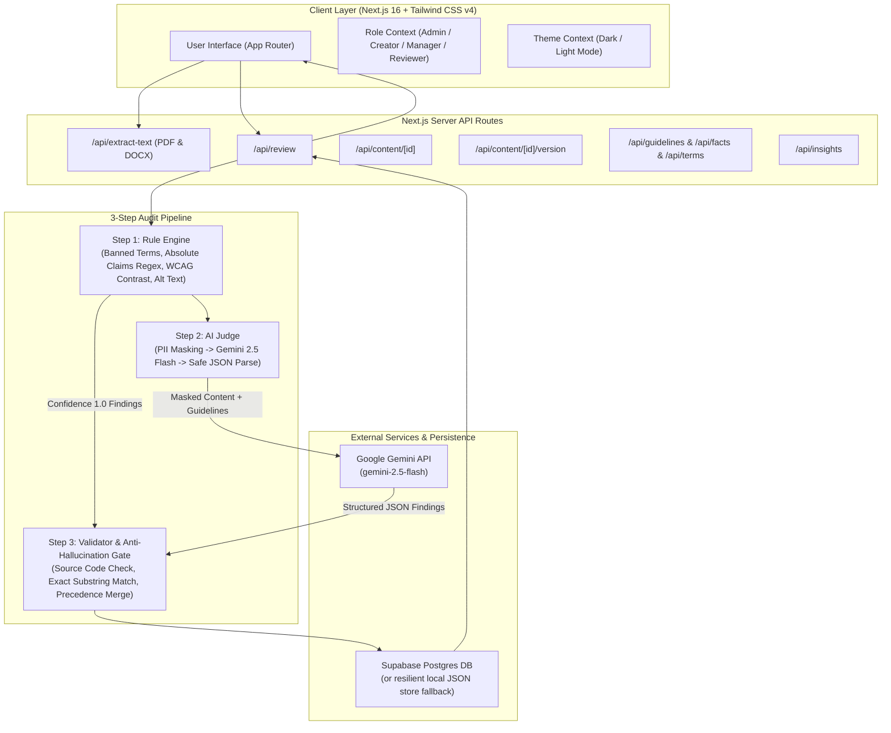
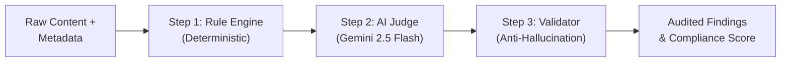

# BrandSentry — Pre-Publication Brand Governance & Compliance Platform

> **Live Governance for Every Word Before It Goes Public.**  
> BrandSentry is a pre-publication brand governance platform built with Next.js 16 (App Router), TypeScript, Tailwind CSS v4, Supabase (Postgres), and the Google Gemini API (`gemini-2.5-flash`).

---

## 1. Executive Summary & Problem Statement

Modern marketing and product organizations publish copy across fragmented channels—social media, press releases, newsletters, and ad campaigns—at unprecedented velocity. Without centralized, pre-publication governance:

- **Brand Drift Occurs:** Variations in capitalization, product naming (e.g. *"Nova Pay"* instead of *"NovaPay"*), and tone creep into customer communications.
- **Regulatory & Legal Exposure:** Writers inadvertently publish absolute claims (*"100% secure"*, *"guaranteed returns"*, *"#1 in the world"*) violating financial advertising and consumer protection regulations.
- **Accessibility Inequities:** Visual campaign imagery ships without descriptive alternative text (`alt`), and low-contrast color palettes fail WCAG 2.1 AA readability standards (< 4.5:1).
- **Factual Inaccuracies:** Unvetted statements contradict corporate truth sets.
- **Review Bottlenecks:** Human legal and brand review teams are overwhelmed with repetitive manual scans.

BrandSentry solves this with an automated **3-Step Pre-Publication Audit Pipeline** that couples deterministic rule execution with responsible, privacy-preserving Google Gemini intelligence, governed by human sign-off.

---

## 2. The Three Committed Improvements (Round 3)

| Improvement | What It Is | Impact on the User Experience |
| :--- | :--- | :--- |
| **1. Source-Verified Findings** | Every finding stores `source_code`, confidence (0–1), and a `verified: boolean` flag. Unmapped or unknown source codes are downgraded to a **"Needs human check"** state (<0.6 confidence). | Content creators and reviewers can verify that every issue is backed by an authentic corporate standard from the Knowledge Base. Each finding card features a **"Verified source"** badge, an active confidence bar, and an explanatory **"Why this was flagged"** panel showing the exact matched trigger span and rule definition. |
| **2. Intent-Preserving Rewrite** | Each finding provides an intent-preserving before/after diff with one-click **Accept Fix**, **Edit**, and **Dismiss / Reject**. Accepting a fix automatically produces a new version `v(N+1)` with re-audited findings. | Creators can resolve compliance violations instantly without changing their intended voice. Includes an **"Undo last accept"** feature that allows writers to revert back to version `v(N-1)` at any time with a single click, maintaining a complete, auditable version history. |
| **3. Guideline Health & Analytics** | Real-time diagnostic monitor evaluating rule effectiveness by tracking how often each guideline is triggered versus rejected by creators during daily copy drafting. | Brand managers can immediately see which guidelines cause friction. Each guideline displays times triggered, times rejected, a clear health status label (**`Clear`** or **`Review wording`**), and a saved **AI-written clarification suggestion**. Includes one-click **Markdown Report Export** for executive compliance reporting. |

---

## 3. Core Features & Capabilities

- **60-Second Demo Flow:** One-click demo on the home page that automatically loads the sample brand pack, populates a flawed draft (*"Our app is 100% secure and the #1 choice!"*), runs the 3-step audit, and opens the review workbench.
- **Document Text Extraction (PDF & DOCX):** Server-side parsing of uploaded `.pdf` (`pdf-parse`) and `.docx` (`mammoth`) documents (up to 5MB) directly into the draft editor.
- **Brand Compliance Score Ring:** Dynamic circular score ring (0–100) computed from finding severities with descriptive health labels (**Ready to Publish**, **Needs Fixes**, **High Risk**).
- **Interactive Review Workbench (`/review/[id]`):** Interactive text highlighting of flagged spans, filter chips by category and severity with count badges, collapsible finding cards, and a sticky bottom action bar.
- **Editorial Review Queue (`/queue`):** Centralized governance inbox for Managers and Reviewers to inspect pending submissions, add threaded comments, approve publication, or request mandatory changes.
- **Version History & Diff Viewer (`/history/[id]`):** Complete audit timeline with split/inline diff comparison between arbitrary versions and chronological discussion logs.
- **Knowledge Base Administration (`/admin`):** Full management for brand guidelines, verified facts, and terminology rules with one-click seed data loading.
- **Role Simulation:** Instant role switching across **Creator**, **Reviewer**, **Manager**, and **Admin** with contextual tooltips and server-side role enforcement (HTTP 403 on unauthorized status transitions).

---

## 4. System Architecture



---

## 5. The 3-Step Review Pipeline



### Step 1: Deterministic Rule Engine (No AI)
- **Banned Terms:** Scans text using word-boundary regular expressions against the `terms` table with case-preserving substitution (e.g. flags `"Nova Pay"` in favor of `"NovaPay"`).
- **Absolute Claim Regex:** Evaluates compliance hazards (`100% secure`, `guaranteed returns`, `#1`, `best in class`, `zero risk`).
- **Visual & Contrast Standards:** Computes WCAG 2.1 relative luminance and contrast ratio between text and background colors (`L = 0.2126*R + 0.7152*G + 0.0722*B`). Flags ratios under 4.5:1. Checks for missing `image_alt` tags on visual assets.
- **Output:** Rule findings assigned `confidence: 1.0`, `is_ai: false`, and verified source codes (`TERM`, `LEGAL-1`, `VIS-1`, `VIS-2`).

### Step 2: AI Judge (`gemini-2.5-flash`)
- **Confidentiality Toggle:** If the author checks *"Mark content Confidential"*, the external AI step is bypassed completely, running rule checks only.
- **Client-Side PII Masking:** All email addresses (`/[a-zA-Z0-9._%+-]+@[a-zA-Z0-9.-]+\.[a-zA-Z]{2,}/g`) and telephone numbers are redacted to `[EMAIL_REDACTED]` and `[PHONE_REDACTED]` before leaving the server.
- **Structured JSON Mode:** Queries `gemini-2.5-flash` with the complete brand guideline set and enterprise facts.
- **Fault-Tolerant Circuit Breaker:** 20-second timeout with an `AbortController`, one automatic retry on timeout or error, and smooth fallback to deterministic rule findings with an alert banner.

### Step 3: Validator & Anti-Hallucination Gate
- **Hallucination Suppression:** Rejects any AI finding whose `quoted_span` is not an authentic substring of the actual content text.
- **Source Code Verification:** Checks that `source_code` corresponds to an authentic code in the `guidelines` or `facts` table; unmapped codes are downgraded to `needs_human_check` with lower confidence.
- **Confidence Gate:** Any finding with confidence < 0.60 is flagged as `needs_human_check`.
- **Precedence & De-duplication:** Overlapping text spans between rule findings and AI findings are merged, prioritizing deterministic rule results.

---

## 6. Technology Stack & AI Disclosure

- **Framework:** Next.js 16 (App Router, Server Actions, API Routes, Turbopack, TypeScript)
- **Styling:** Tailwind CSS v4 (responsive, accessible, dark/light theme support)
- **Database:** Supabase Postgres via `@supabase/supabase-js` (with automatic resilient local JSON store fallback for zero-friction evaluation)
- **AI Model:** Google Gemini API (`gemini-2.5-flash` with structured JSON output mode)
- **Document Ingestion:** `pdf-parse` (PDF extraction) and `mammoth` (DOCX extraction)
- **Testing:** Vitest 5.1 (automated unit and regression testing)
- **Icons & Tooling:** `lucide-react`, `diff`
- **AI Disclosure:** This application uses the Google Gemini 2.5 Flash model for automated copy evaluation. The application was designed, prototyped, and engineered with AI assistance in **Google Antigravity**.

---

## 7. Reliability, Edge Cases & Error Handling

- **Input Boundaries:** Handles empty, whitespace-only, and excessively long inputs (capped at 50,000 characters for body, 200 characters for title) with friendly feedback.
- **Double-Click Prevention:** Action buttons (`Accept Fix`, `Submit for Approval`, `Run Audit`) disable immediately during processing to prevent duplicate versions or race conditions.
- **Idempotent Server Actions:** Version creation and status updates enforce idempotency on the server.
- **Server-Side Role Restrictions:** Role authorization is validated on the server: only Managers and Admins can approve content (HTTP 403 returned to unauthorized callers).
- **Graceful Circuit Breaker:** If Gemini API experiences network timeouts or rate limits, the audit completes via rule-based analysis without crashing or hanging.
- **Safe JSON Sanitization:** Malformed JSON from LLM outputs is safely stripped and parsed; invalid individual findings are discarded without failing the audit.
- **Direct 404 Route:** Navigating directly to a missing or deleted content ID renders an accessible, branded 404 page (`src/app/not-found.tsx`).

---

## 8. Accessibility & Usability (WCAG 2.1 AA)

- **Color Contrast:** All UI elements exceed 4.5:1 contrast ratios in both dark and light modes.
- **Non-Color Severity Indicators:** Findings do not rely on color alone; each displays dedicated severity icons (`AlertOctagon`, `AlertTriangle`, `Info`) and uppercase labels (`HIGH RISK`, `MEDIUM`, `LOW`).
- **Screen Reader Announcements:** Dynamic score updates and findings counts are announced via `aria-live="polite"` regions.
- **Keyboard Navigation:** Full keyboard navigation support with prominent focus rings (`focus-visible:ring-2`).
- **Responsive Layout:** Fluid layout down to 375px viewport width with no horizontal overflow.

---

## 9. Setup & Local Installation

### Prerequisites
- Node.js 18+ (tested on Node 20 and 24)
- npm or pnpm
- (Optional) Supabase project credentials and Google AI Studio API key

### 1. Clone & Install
```bash
git clone https://github.com/Shaurya0117/brandsentry.git
cd brandsentry
npm install --legacy-peer-deps
```

### 2. Configure Environment Variables
Create a `.env.local` file in the project root:
```env
# Google Gemini API Key (Server-only)
GEMINI_API_KEY=your_gemini_api_key_here

# Supabase Credentials (Optional for local file store, required for cloud Postgres)
NEXT_PUBLIC_SUPABASE_URL=https://your-project.supabase.co
SUPABASE_SERVICE_ROLE_KEY=your-supabase-service-role-key
```

> **Note:** If `GEMINI_API_KEY` or Supabase credentials are not provided, BrandSentry automatically runs using its deterministic rule engine and local JSON database storage (`/data/store.json`). It will never crash.

### 3. Initialize Supabase Database (Optional)
1. In your [Supabase Dashboard](https://supabase.com), open the **SQL Editor**.
2. Run the DDL script at [`supabase/schema.sql`](supabase/schema.sql).
3. (Optional) Run [`supabase/seed.sql`](supabase/seed.sql) to pre-seed the Nova Bank brand pack.

### 4. Run Development Server
```bash
npm run dev
```
Open [http://localhost:3000](http://localhost:3000) in your browser.

### 5. Run Automated Tests
```bash
npm test
```
See [`docs/TESTING.md`](docs/TESTING.md) for the complete test case matrix.

---

## 10. Deploying to Vercel

1. Push your repository to GitHub (`main` or `round3-final` branch).
2. Import the project in the [Vercel Dashboard](https://vercel.com/new).
3. Add the environment variables:
   - `GEMINI_API_KEY`
   - `NEXT_PUBLIC_SUPABASE_URL`
   - `SUPABASE_SERVICE_ROLE_KEY`
4. Click **Deploy**. Next.js App Router routes deploy as serverless functions automatically.

Live deployment URL: [https://brandsentry-two.vercel.app](https://brandsentry-two.vercel.app)

---

## 11. Screenshots & UI Walkthrough

| Screen | Description |
| :--- | :--- |
| **Home Page & 60s Demo** | Features the 3-step "How it works" strip, one-line trust row, and one-click demo launcher. |
| **Review Workbench** | Interactive text highlighting, circular Brand Compliance Score ring, and sticky action bar. |
| **Findings Panel** | Shows "Verified source" badge, confidence bar, "Needs human check" state, and "Why this was flagged" panel. |
| **Intent-Preserving Rewrite** | Side-by-side diff with Accept Fix, Edit, Reject, and Undo Last Accept. |
| **Guideline Health** | Analytics showing times triggered, times rejected, health labels (`Clear` / `Review wording`), and Markdown report export. |

---

## 12. Known Limitations & Roadmap

### Current Limitations
1. **Role Authentication:** User roles are simulated via client context and `localStorage` for rapid demonstration without requiring OAuth identity infrastructure.
2. **Context Window Scale:** The AI Judge provides active guidelines and facts within prompt context. This approach is optimal for brand packs up to ~200 items; larger enterprise packs would benefit from hybrid vector search (`pgvector`).
3. **External LLM Latency:** Gemini 2.5 Flash completes audits in ~1–2 seconds. In case of network timeout, the 20-second circuit breaker automatically falls back to deterministic rule findings.

### Roadmap
- [ ] Enterprise SSO integration (Okta, SAML 2.0, Google Workspace).
- [ ] Automated Figma plugin integration to audit live canvas copy and banner typography.
- [ ] Multi-lingual brand rule packs (Spanish, French, German, Japanese).
- [ ] Vector database indexing (`pgvector`) for corporate brand libraries exceeding 10,000 guidelines and claims.
